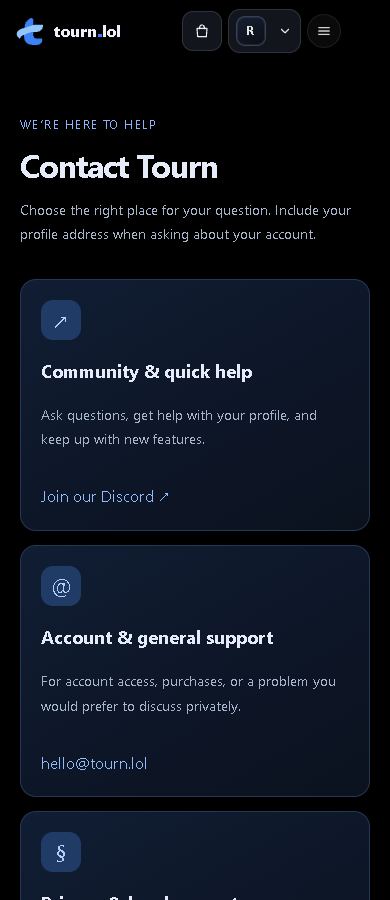
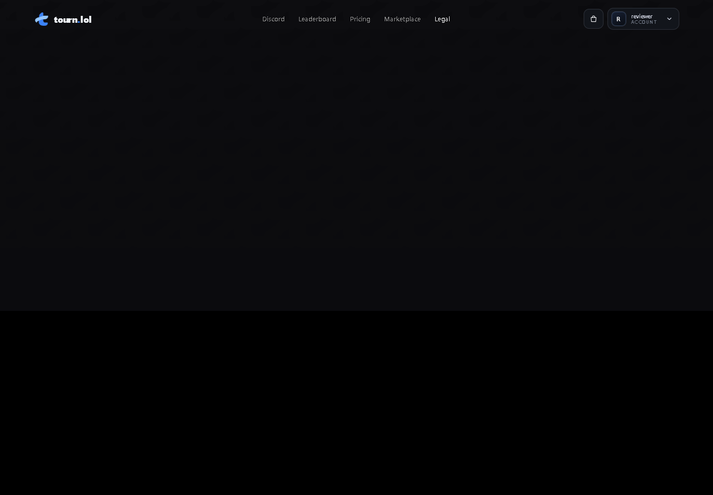
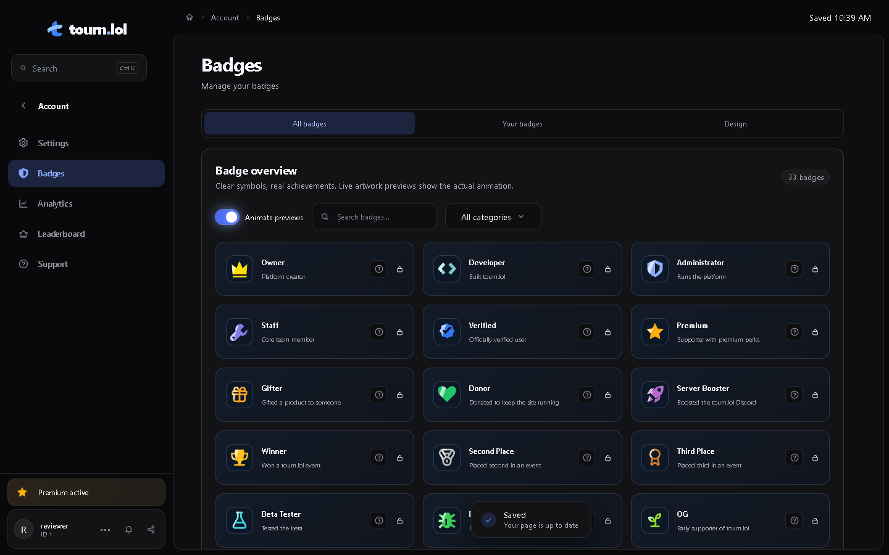
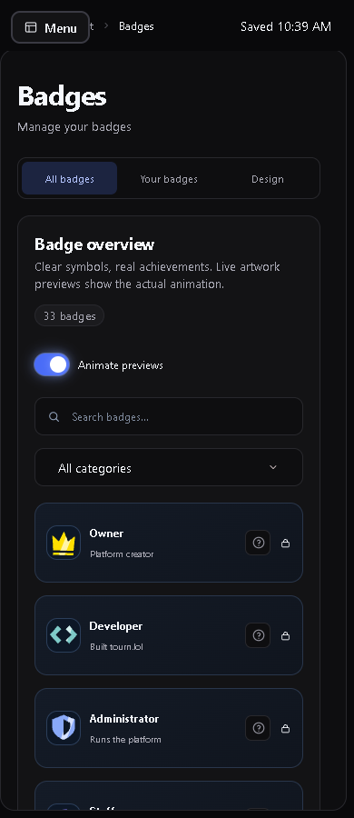

# Contact, footer colour and badge motion

Contact now has a lightweight page at /contact and #/contact, with actual support email, legal email and Discord destinations. The footer links to it. The route is reserved for future username claims; explicit #/profile/<handle> profile URLs continue to work. Legal-page contact remains at #/legal/contact.

Public footers use a navy gradient and blue surfaces independently of the homepage. Legal pages use a readable content column and sticky contents navigation on desktop, with stacked sections and a two-column contents list on phones. Contact cards stack on small screens. Legacy settings/admin styles replace red-tinted text, borders and panels with blue, including old rgba colours. Remaining fixed violet action colours in the marketing stylesheet use blue.

Badge artwork is generated locally from existing licensed geometry using scripts/build-badge-motion.mjs. The SVGs animate the symbol and sweep a clipped highlight over it. Stroke/fill attributes and license notices are preserved. The catalogue previews animate without hovering and have a separate Animate previews switch. Public badge chips use the profile animation setting and the operating system's reduced-motion preference to choose animated or still artwork. Badge cards have more room around icons and actions.

Validation: TypeScript, production build and bundle budgets; Contact direct/hash routing; legal Contact footer; Contact at 320/390/1440 widths; footer regression at four widths; badge image pixels compared over time; still-preview pixel stability; reduced-motion fallback. Screenshots use a mocked account.

The username suite also passes all 15 tests after updating its local fixture with the existing alias_required database column. Mobile badge cards are checked for clipped content at 320px and 390px.

