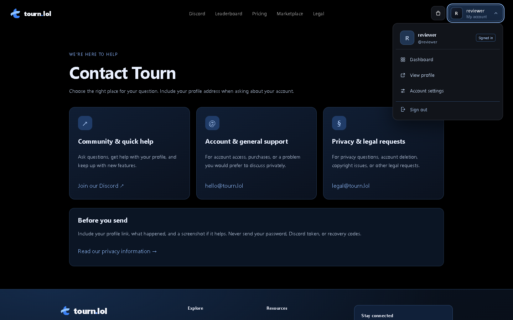
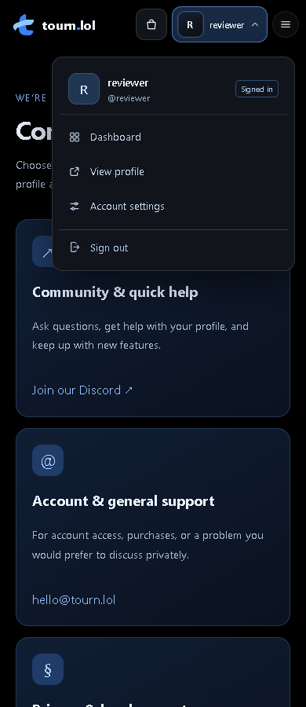
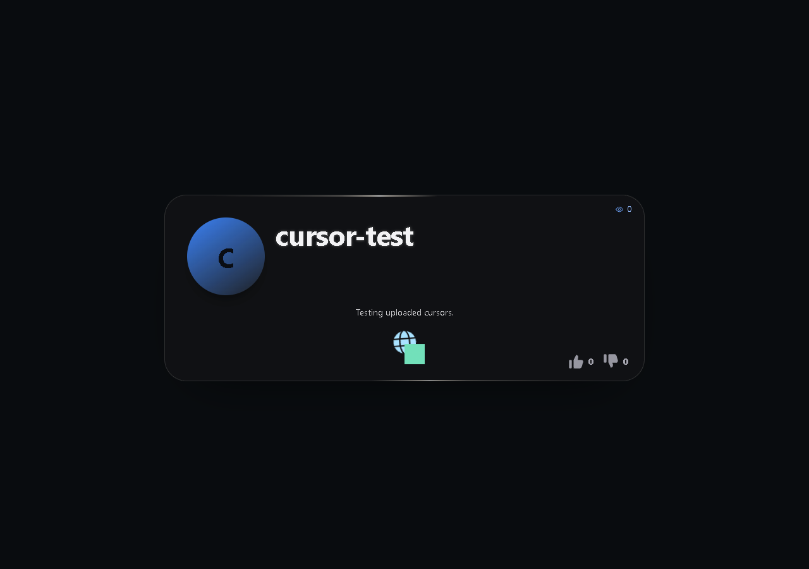

# Custom cursor and account menu

Uploaded cursor images now use a lightweight, profile-scoped DOM cursor, portalled above clipped or transformed profile elements. Movement updates its transform once per animation frame without rendering React on every mouse move. It switches to the saved link pointer over interactive elements and applies the prepared click hotspot in the same 32px coordinate space. GIF sources are retained rather than flattened, with their hotspots scaled to the displayed size.

The native cursor is hidden only after the uploaded image loads. Broken images retain the native fallback, and leaving the profile or unmounting restores it. Touch input does not display the uploaded cursor. Applying a cursor from the asset library now selects custom mode as well as saving its image.

The top-right account trigger has a larger avatar, readable name and a normal-case secondary label. Its blue dropdown has an account summary, Dashboard, View profile, Account settings and Sign out, while retaining the owner-only alias action. It supports opening and closing motion, arrow keys, Home/End, Escape with focus restoration, outside-click dismissal and reduced motion. Mobile menus stay within the viewport.

Validation: TypeScript, production build and bundle budgets; account-menu interaction checks at 320px, 390px and 1440px; rendered custom cursor image/position and click hotspot; separate link pointer; GIF source preservation and size; broken-image fallback and cleanup. Footer and Contact/badge regressions also pass. Screenshots use mocked accounts and simple cursor artwork for testing.

