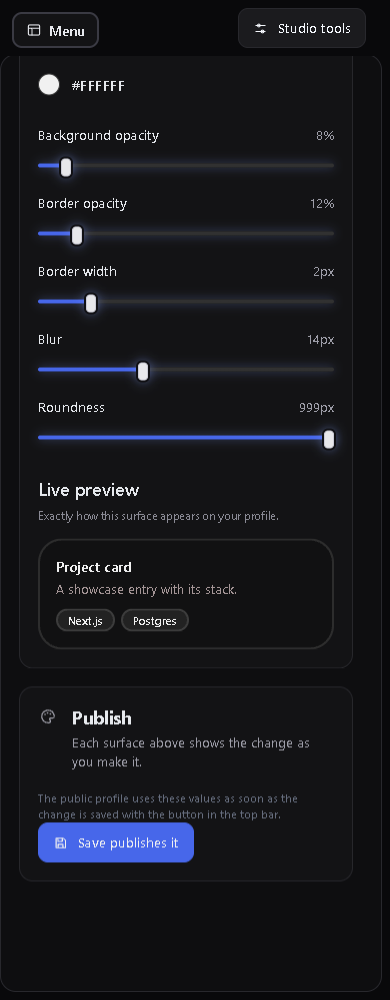
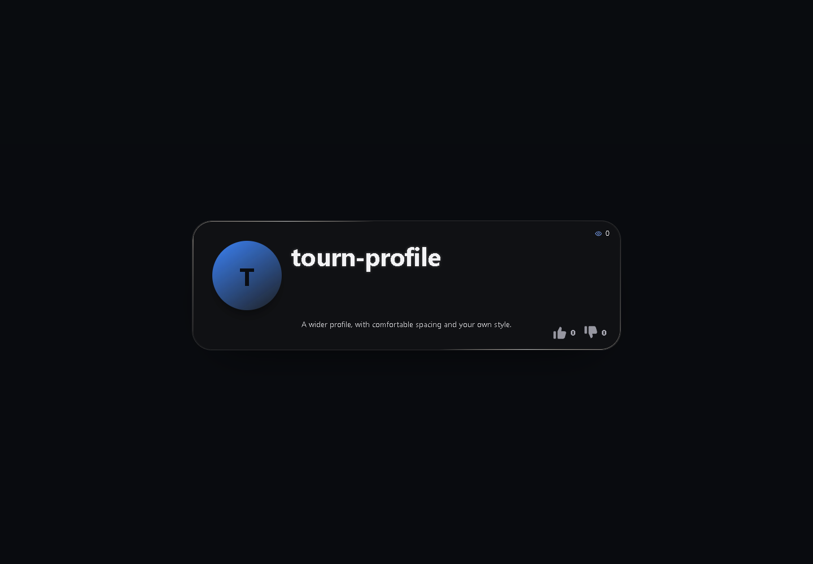
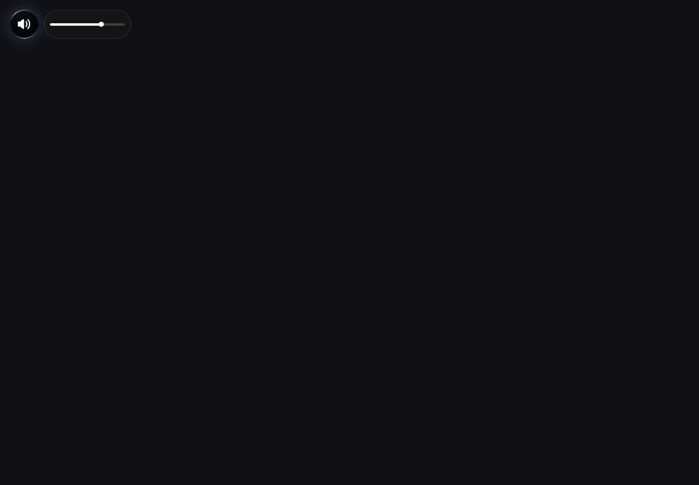

# Dashboard spacing and profile audit

This update addresses shared spacing and sizing rather than claiming every proposed backlog item is a confirmed bug.

## Verified changes

- Buttons have consistent icon gaps, stable SVG sizing, wrapping labels, and at least 40px height.
- Card headers can put actions on a separate row; long copy can wrap.
- Slider labels wrap while their numeric values remain separate. Range controls reserve 24px of height for their thumbs.
- Colour controls explicitly keep swatches and values in one row.
- Mobile audio colours no longer force an implicit second grid column.
- Phone dashboard padding is 18px. Section headings and explanatory hints stack instead of squeezing each other.
- Standard public profiles widen from 648px to 760px, including previously saved standard-width profiles. Existing version-6 custom widths are preserved. Gallery, portfolio and skills sections follow the selected width.
- The mute rail uses a single state-controlled transition, honours the configured duration, captures volume drags, closes with Escape, opens inward from right corners, and respects reduced motion.

## Screenshots

Screenshots use a mocked account, not a live user's account. The audit script also captures top and bottom scroll positions for eight editor routes at 1440px, 768px and 390px widths; its 48 generated captures live under .tmp.

Phone spacing and stacked preview heading:

760px desktop profile:

Animated mute control in its open state:

## Validation

- TypeScript and Vite production build.
- Dashboard navigation and setup interactions.
- 27 dashboard routes at three viewport widths, with no horizontal page overflow or runtime errors in the fixture.
- Eight editor routes at three widths, checking slider-label collisions and field containment.
- Measured 760px rendered profile width, legacy standard-width migration, retained 900px custom width, and mobile containment.
- Mute animation sampled during both transitions, drag held outside the control, keyboard opening, Escape dismissal, right-corner placement, and reduced motion.

The full 200-item backlog is in [dashboard-200-improvements.md](dashboard-200-improvements.md). Implemented items are labelled; the rest are proposals and follow-up checks.
