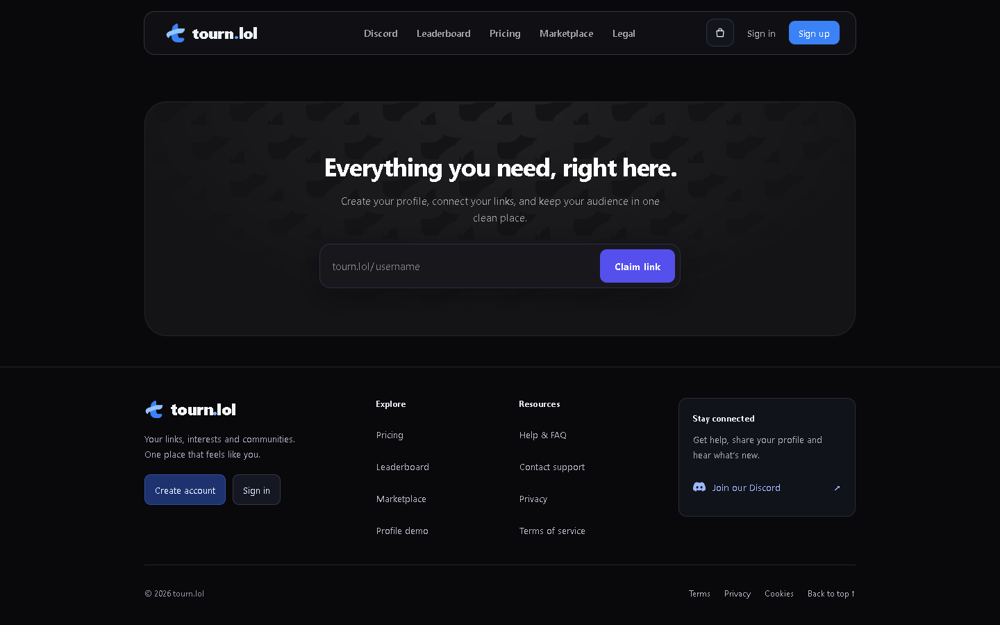

# Footer and initial-loading update

The public-site footer now has Explore and Resources link groups, clear account actions, a compact Discord panel, specific legal destinations, and a back-to-top link. All groups remain visible on phones in two columns. Controls have at least 44px target height, keyboard focus styling, and safe-area bottom padding. The language selector and the Redeem Code action were removed because they did not provide the functionality their labels implied.

The footer lives in its own lightweight component and stylesheet. Legal, pricing and other public pages no longer need the homepage showcase module merely to display their footer. The homepage hero also has a separate module and a nested loading boundary for its profile preview, so the headline and primary action can render while preview code is still downloading. Idle profile warming now considers only links actually in the viewport.

## Verification

- TypeScript and Vite production build.
- JavaScript bundle budget check.
- Browser tests at 320px, 390px, 768px and 1440px: no footer overflow, all links visible, 44px targets, correct mobile padding.
- Legal destinations, FAQ navigation and sign-in action.
- Held the profile-preview module request pending and verified the heading, preview placeholder and footer still render.

This verifies the removal of a loading dependency, not a guaranteed connection-independent load time.

