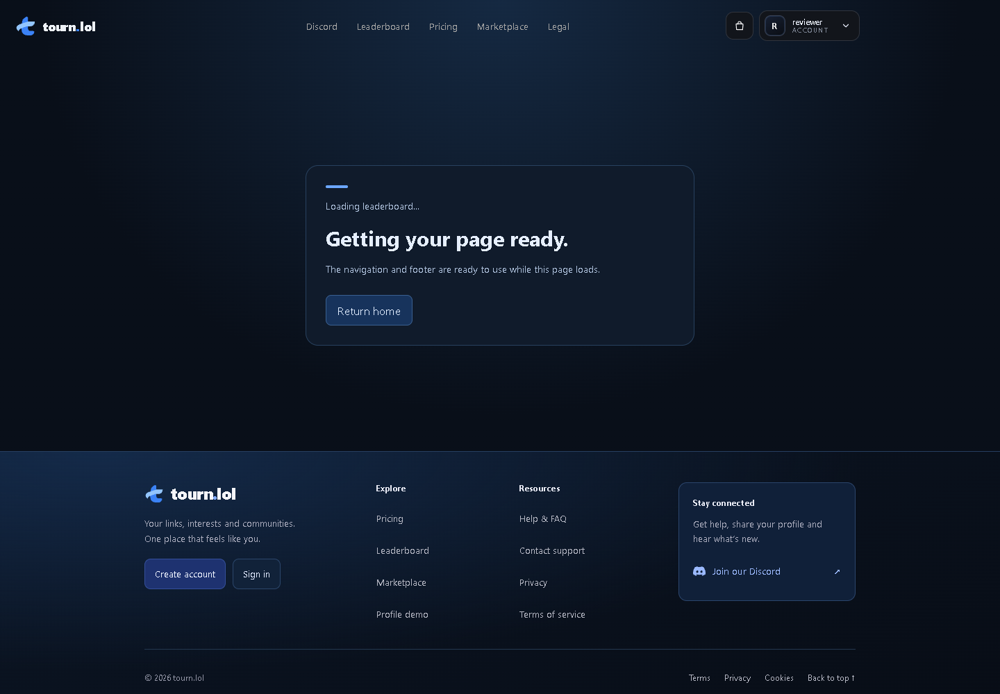
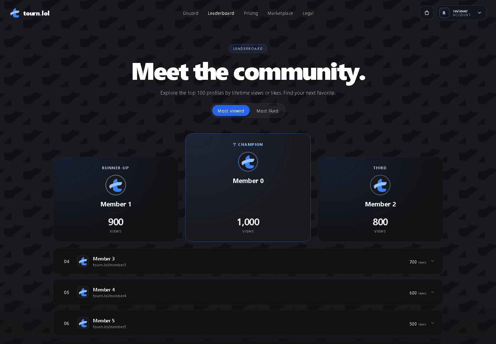
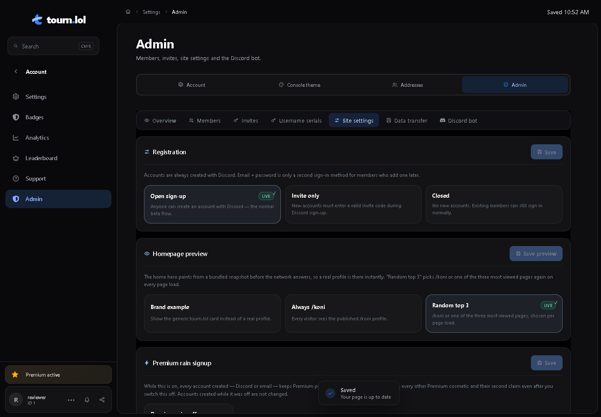

# Public-page paint and Admin palette fix

The fixed .site-backdrop used z-index: 0 inside the app stacking context. Non-positioned page content and footers could paint underneath that black canvas. Their DOM text, bounding boxes and computed opacity still looked valid, so visibility-only browser assertions missed the obstruction.

The ambient canvas now stays at z-index: -1 within an isolated site context. Public main content and the footer have explicit positioned layers above it. Public pages also paint without reveal classes, and their main container no longer starts as a transparent route animation.

The public-page Suspense boundary now shows a readable loading surface rather than an empty fallback. The footer and navigation stay available while a route module downloads. After eight seconds, a retry control appears. Profile rendering retains its existing separate loading behavior.

Admin's pale pink and red-tinted neutral CSS colours now use cool blue equivalents. Its own controls use blue variables independently of a stored console accent. Three legacy red accent values migrate to the current blue default.

## Verification

- A held route-module request exposes the loading state and delayed retry action.
- A screenshot pixel sample confirms that the blue loading surface actually paints above the black canvas.
- Leaderboard, Pricing, Marketplace, Legal and Contact render with reveal classes removed and route animation paused.
- Seven Admin sections, including the member editor, are checked for warm/red computed text, backgrounds and borders using a mocked owner account.
- Footer navigation and responsive regression checks, TypeScript, production build and bundle budget.

